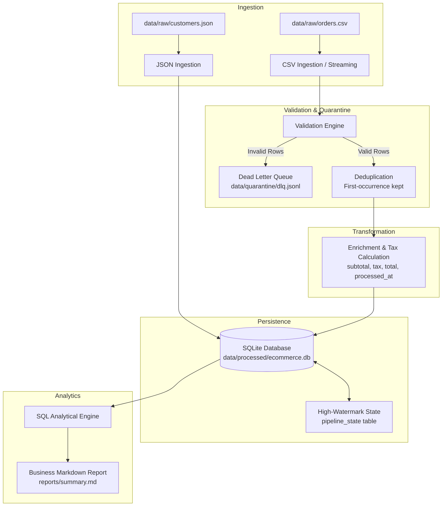

# Mini E-Commerce Data Engineering Pipeline

A lightweight, robust, production-grade ETL (Extract, Transform, Load) data pipeline written in Python and SQL (SQLite). The core pipeline relies strictly on Python's standard library (`csv`, `json`, `sqlite3`, `logging`, `dataclasses`, `datetime`), ensuring zero external runtime dependencies while demonstrating battle-tested data engineering patterns.

---

## Architecture Flowchart



---

## Core Engineering Features

1. **Streaming Ingestion ($O(1)$ Memory Footprint)**
   - Includes lazy generator streaming (`stream_csv_records`) that yields cleaned records line-by-line using Python's `csv.DictReader`, guaranteeing constant memory usage even for massive CSV files.
2. **Schema & Business Rule Validation**
   - Validates each raw order across multiple rules (positive ID, non-empty customer/product IDs, valid ISO dates, strictly positive quantity, non-negative unit price).
   - Collects all validation errors for a given record rather than failing fast on the first error.
3. **Dead Letter Queue (DLQ)**
   - Corrupted and malformed records are isolated in line-delimited JSON Lines (`.jsonl`) format (`data/quarantine/dlq.jsonl`), preserving raw payloads, error reasons, and UTC timestamps for auditability without blocking clean batches.
4. **In-Memory Deduplication**
   - Automatically tracks seen `order_id`s in a hash set to separate unique orders from duplicates, preserving the first instance and logging duplicate occurrences.
5. **Idempotent Persistence & ACID Transactions**
   - Enforces foreign key constraints in SQLite via `PRAGMA foreign_keys = ON;`.
   - Utilizes SQL upserts (`ON CONFLICT(customer_id) DO UPDATE SET ...`) for customers and duplicate skips (`ON CONFLICT(order_id) DO NOTHING`) for orders to ensure the pipeline can be safely rerun without duplicating data.
6. **High-Watermark Incremental Loading**
   - Persists state in `pipeline_state` with the maximum processed `order_date`.
   - On incremental runs (`incremental=True`), only records newer than the saved watermark are ingested and processed.
7. **Analytical SQL Reporting**
   - Runs ANSI SQL queries using SQLite's `row_factory = sqlite3.Row` to calculate:
     - Daily Revenue Summary (order counts, total revenue, average order value).
     - Top Customers Ranking (handled with `LEFT JOIN` and `COALESCE` to prevent `NULL` corruption).
     - Product Performance metrics.
   - Automatically generates a formatted report in `reports/summary.md`.
8. **Automated Pytest Suite**
   - Complete unit tests verifying schema validation, DLQ routing, deduplication, financial transformations, and transactional database integrity using in-memory databases (`:memory:`).

---

## Quickstart Guide

### 1. Clone & Set Up Virtual Environment

**Windows (PowerShell):**
```powershell
# Clone the repository
git clone https://github.com/your-username/fluffy-broccoli.git
cd fluffy-broccoli

# Create and activate virtual environment
python -m venv venv
.\venv\Scripts\Activate.ps1

# Install test dependencies
pip install -r requirements.txt
```

**macOS / Linux:**
```bash
# Clone the repository
git clone https://github.com/your-username/fluffy-broccoli.git
cd fluffy-broccoli

# Create and activate virtual environment
python3 -m venv venv
source venv/bin/activate

# Install test dependencies
pip install -r requirements.txt
```

---

### 2. Run the Unit Test Suite

Execute `pytest` to verify validation, transformation, and database idempotency:

```bash
pytest -v
```

To run tests with test coverage reporting:
```bash
pytest --cov=src -v
```

---

### 3. Run the Pipeline

Execute the full end-to-end pipeline:

```bash
python -m src.pipeline
```

### 4. Generate the Analytics Report

Run the analytical engine to build the markdown summary:

```bash
python -c "from src.database import get_connection; from src.analytics import generate_markdown_report; conn = get_connection('data/processed/ecommerce.db'); generate_markdown_report(conn); conn.close(); print('Report generated at reports/summary.md')"
```

---

## Trade-offs & Production Next Steps

While this architecture is purposefully lightweight, portable, and zero-dependency for local development and embedded scenarios, scaling to an enterprise production environment involves the following evolutions:

| Local Architecture (Current) | Cloud Production Scale (AWS / GCP) | Engineering Rationale |
| :--- | :--- | :--- |
| **Storage: Local CSV/JSON Files** | **AWS S3 / Google Cloud Storage (GCS)** | Object stores provide infinite scalability, versioning, event triggers (S3 ObjectCreated), and lifecycle tiering. |
| **Compute: Single-process Python script** | **Apache Airflow / Dagster / AWS Step Functions** | Dedicated orchestrators handle distributed retries, SLA monitoring, backfilling, alerting, and visual DAG tracking. |
| **Validation: Python-level loops** | **Great Expectations / Pydantic / AWS Glue DataBrew** | Declarative schema validation suites that integrate directly with data catalogs and generate automated data quality profiling dashboards. |
| **Database: Embedded SQLite** | **PostgreSQL (OLTP) & Snowflake / BigQuery / Redshift (OLAP)** | SQLite allows only one writer at a time. Cloud data warehouses separate compute and storage and leverage columnar indexing for billion-row aggregations. |
| **Incremental Watermarks: SQLite Table** | **Delta Lake / Iceberg Commit Logs or dbt state** | Modern table formats natively support time travel, schema evolution, ACID merges, and partition pruning. |

